<!-- Midnight Console: edit profile text here; artwork lives in assets/. -->

  <picture>
    <source media="(prefers-color-scheme: dark)" srcset="./assets/midnight-console.svg" />
    
  </picture>

  

    
    
  

### `> whoami`

I'm **Himel**. I build Telegram tools and automation with **Python** and **Telethon**, and explore **APIs** and **desktop applications** with **PySide6**.

### `01 / the toolkit`

  

  
  
  

### `02 / the automation loop`

<picture>
  <source media="(prefers-color-scheme: dark)" srcset="./assets/automation-flow.svg" />
  
</picture>
