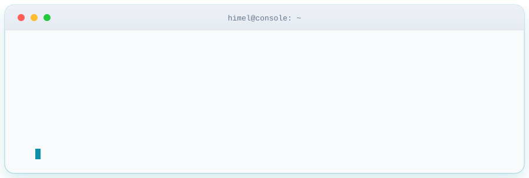

<!-- Midnight Console: edit profile text here; artwork lives in assets/. -->

  <picture>
    <source media="(prefers-color-scheme: dark)" srcset="./assets/midnight-console.svg" />
    
  </picture>

  

  

    
    
    
  

---

### `> whoami`

I'm **Himel**. I build Telegram tools and automation with **Python** and **Telethon**, and explore **APIs** and **desktop applications** with **PySide6**.

<!-- Animated terminal: terminal.svg (dark) and terminal-light.svg (light) must be in the repo root -->

  <picture>
    <source media="(prefers-color-scheme: dark)" srcset="./terminal.svg" />
    
  </picture>

---

### `01 / the toolkit`

  
  
  
  
  

  
  
  
  
  

---

### `02 / the automation loop`

<picture>
  <source media="(prefers-color-scheme: dark)" srcset="./assets/automation-flow.svg" />
  
</picture>

---

### `03 / what I build`

| Tool type | What it does |
| :-- | :-- |
| **Multi-account panels** | Manage many Telegram accounts from one desktop app (PySide6 + Telethon) |
| **Bot automation** | Referral and task bots with isolated per-bot queues |
| **Community hubs** | One entry point for channels, groups and bots |
| **Custom launchers** | Themed, clean UIs with logic kept separate from interface code |

<!-- Tip: replace the table above with pinned repos once you want to link projects publicly. -->

---

### `04 / stats`

  

---

### `05 / let's connect`

Have an idea for a tool, a bot or an automation? Message me on Telegram.

  
    
  <code>while True: build() ; fix_bugs() ; repeat()</code>

